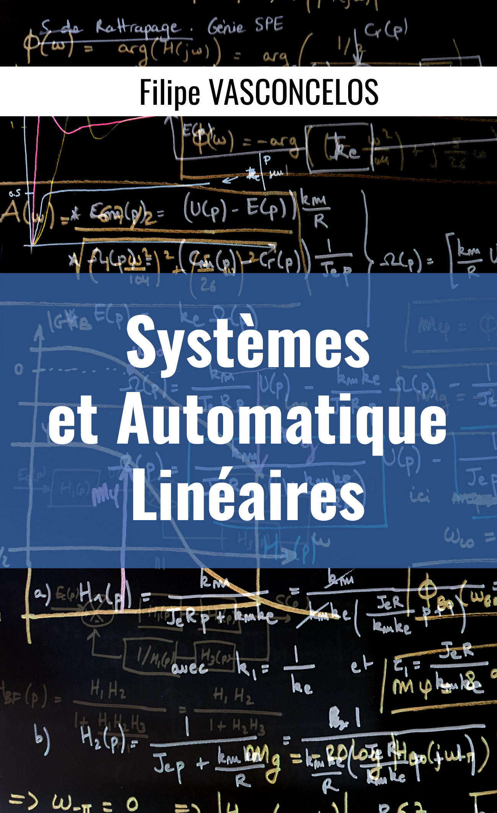
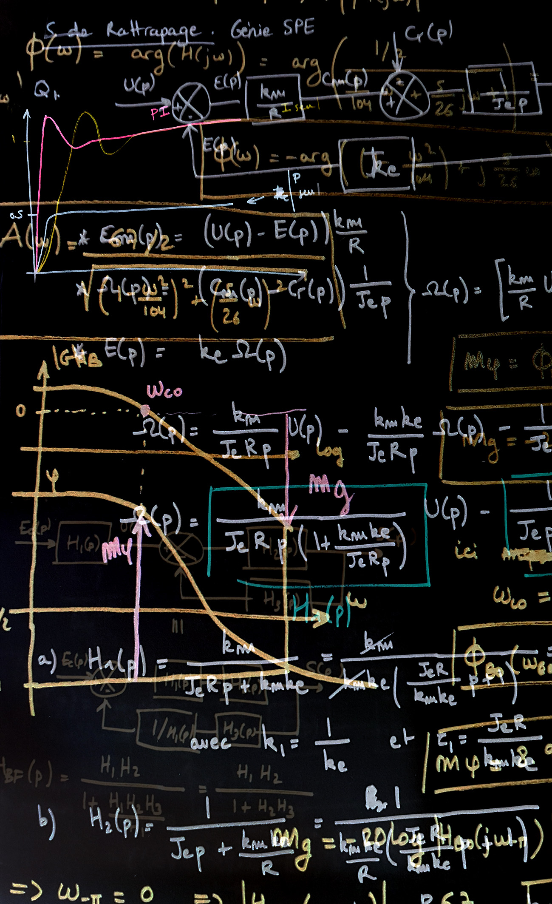

# Systèmes et automatique linéaires

## Contexte

Ce document est le résultat de l'enseignement dispensé de janvier 2018 
à juin 2022 en deuxième année de l'ESME Sudria. Celui-ci était associé 
au module de Systèmes Mécaniques et Automatiques (SMA).

## Compilation

### Prérequis
- Distribution TeX Live (version complète recommandée) avec `pdflatex`, `bibtex`, `makeindex` et `makeglossaries`
- `make`
- Python et [Pygments](https://pygments.org/) (`pip install Pygments`), requis par le package `minted`
- Packages locaux `mintedscilabfmv`, `tcolorfmv` et `siunitxfmv` : fournis dans `preamble/`, ils ne sont **pas** installés automatiquement. Copiez-les dans votre arbre TeX utilisateur (Linux/macOS) :
  ```
  d="$(kpsewhich -var-value TEXMFHOME)/tex/latex/syslinauto"
  mkdir -p "$d" && cp preamble/*.sty "$d"
  ```
  Vérification : `kpsewhich tcolorfmv.sty` doit afficher un chemin. Pensez à recopier les fichiers si le dépôt les met à jour.

### Commandes
```
make full    # figures TikZ, PDF, bibliographie, index, glossaires, puis 2 passes
make pdf     # compile le PDF (une passe)
make clean   # supprime les fichiers auxiliaires
```

La compilation utilise `pdflatex -shell-escape` (nécessaire à `minted`). 
Le dossier `figtikz/` est généré par `make standalone` à partir de plus de 400 figures : la première compilation est très longue.


## PDF (dernière version)
[PDF](syslinauto.pdf)

## Sommaire 

### Chapitres :
 * Chapitre 1 - Systèmes linéaires, continus
 * Chapitre 2 - Schémas fonctionnels 
 * Chapitre 3 - Modélisation des SLCI 
 * Chapitre 4 - Analyse fréquentielle 
 * Chapitre 5 - Asservissement Linéaire 
 * Chapitre 6 - Performances des systèmes 
 * Chapitre 7 - Stabilité des systèmes asservis 
 * Chapitre 8 - Correction des systèmes asservis
 * Chapitre 9 - Représentation d'état 
### Annexes :
 * Annexe A - Alphabet Grec
 * Annexe B - Unités du Système International  
 * Annexe C - Pierre-Simon de Laplace 
 * Annexe D - Transformation de Laplace 
 * Annexe E - Les nombres complexes 
 * Annexe F - Analyse de Fourier 
 * Annexe G - Équations différentielles à coefficients constants 
 * Annexe H - Décomposition en éléments simples 
 * Annexe I - Systèmes du second ordre 
 * Annexe J - Initiation à Scilab 
 * Annexe K - Initiation à Matlab 
 * Annexe L - \'Echelle logarithmique et le décibel 
 * Annexe M - Transformée de Laplace inverse 
 * Annexe N - Abaque de Black-Nichols 
 * Annexe O - Principe de l'argument de Cauchy 
 * Annexe P - Lieu d'Evans (lieu des racines) 
 * Annexe Q - Différentes architectures des correcteurs PID

## Page de couverture (Illustration : Lorraine Bayard)
 

## Auteur
[Filipe Manuel Vasconcelos (Enseignant à ESME Lille)](https://sites.google.com/site/filipemanuelvasconcelos)
